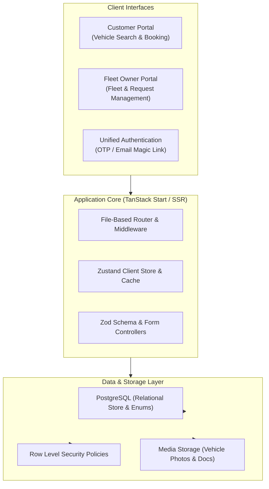

<h1 align="center">LogiFlow</h1>

<p align="center">
  Enterprise Logistics Marketplace & Fleet Management Platform
</p>

<p align="center">
  
  
  
  
  
  
</p>

---

## Overview

**LogiFlow** is a modern, high-performance logistics marketplace and fleet management solution connecting cargo owners, businesses, and shippers with verified truck and tempo operators. Engineered with TanStack Start, React 19, and Supabase, the platform delivers real-time vehicle booking, intelligent dispatching, transparent pricing, and comprehensive fleet monitoring across intra-city and inter-city routes.

---

## System Architecture



---

## Key Features

### For Shippers & Cargo Customers
- **Multi-Category Fleet Discovery**: Instant search across Mini Trucks, Tempos, Pickups, Container Trucks, Heavy Trailers, and Refrigerated Vans.
- **Dynamic Capacity Filtering**: Filter by tonnage, volume capacity, city of operation, and base fare.
- **Streamlined 3-Step Booking**:
  1. *Origin & Destination*: Geocoded pickup and delivery addresses.
  2. *Cargo Specification*: Weight (kg), freight category, and distance calculations.
  3. *Scheduling & Confirmation*: Instant quote estimation with real-time driver dispatch.
- **Live Status Tracking**: Monitor trips through `pending`, `accepted`, `in_transit`, and `delivered` stages.
- **Digital Invoicing**: Automated receipt generation (`RCPT-XXXXXXXXXX`) and payment records.
- **Ratings & Reviews**: Transparent post-trip review system ensuring service reliability.

### For Transporters & Fleet Owners
- **Digital Fleet Onboarding**: Register vehicles with registration plates, capacity, city base, and pricing formulas.
- **Document & Photo Management**: Secure upload of permits, RC books, and vehicle inspections to dedicated storage buckets.
- **Interactive Dispatch Center**: Real-time incoming booking requests with one-click Accept or Reject.
- **Availability Controls**: One-tap toggle for vehicle online/offline statuses.
- **Earnings & Trip Analytics**: Track total trips completed, gross revenue, and customer ratings.

---

## Technology Stack

- **Framework**: TanStack Start (SSR, File-based routing, Nitro server runtime)
- **Frontend Core**: React 19, TypeScript
- **State Management**: TanStack Query (React Query v5), Zustand
- **Styling & Design System**: Tailwind CSS v4, Radix UI Primitives, Lucide Icons
- **Animation & Visuals**: Framer Motion, Recharts
- **Forms & Validation**: React Hook Form, Zod
- **Backend & Storage**: Supabase (PostgreSQL, Row Level Security, Auth, Storage)

---

## Database Architecture

LogiFlow is powered by a relational PostgreSQL schema secured with Row Level Security (RLS):

- `profiles`: User account details, contact information, and role assignments.
- `user_roles`: Role-based access control (`customer`, `owner`, `admin`).
- `vehicles`: Fleet inventory with vehicle type, capacity, rates, and availability.
- `bookings`: Trip contracts with references, timestamps, pricing, and lifecycle states.
- `payments`: Transaction records with payment provider references.
- `receipts`: Tax and subtotal breakdowns with unique receipt identifiers.
- `tracking`: Milestone timestamp updates for in-transit shipments.
- `notifications`: Real-time user notification events.
- `reviews`: Customer ratings (1-5 stars) and feedback.

---

## Getting Started

### Prerequisites
- Node.js 20+
- npm, pnpm, or bun

### 1. Clone the Repository
```bash
git clone https://github.com/dipzz0/LogiFlow.git
cd LogiFlow
```

### 2. Install Dependencies
```bash
npm install
```

### 3. Setup Environment Variables
Create a `.env` file in the project root:
```bash
cp .env.example .env
```
Fill in your credentials from your Supabase project dashboard:
```env
VITE_SUPABASE_URL=https://your-project.supabase.co
VITE_SUPABASE_PUBLISHABLE_KEY=your-publishable-key
SUPABASE_URL=https://your-project.supabase.co
SUPABASE_PUBLISHABLE_KEY=your-publishable-key
```

### 4. Run the Development Server
```bash
npm run dev
```
Open [http://localhost:3000](http://localhost:3000) in your browser to view the application.

---

## Security & Data Integrity

- **Environment Decoupling**: Sensitive credentials, keys, and tokens are strictly kept out of version control via `.gitignore`.
- **Row Level Security**: Database queries are strictly gated at the database layer; customers and owners access only authorized records.
- **Isolated Storage**: Document uploads and vehicle media are partitioned by user ID in storage buckets with verification policies.

---

## License

This project is licensed under the [MIT License](LICENSE) — feel free to use, modify, and build upon it.

---

## Author

Developed by **Dipesh Prajapati**  
GitHub: [@dipzz0](https://github.com/dipzz0)
